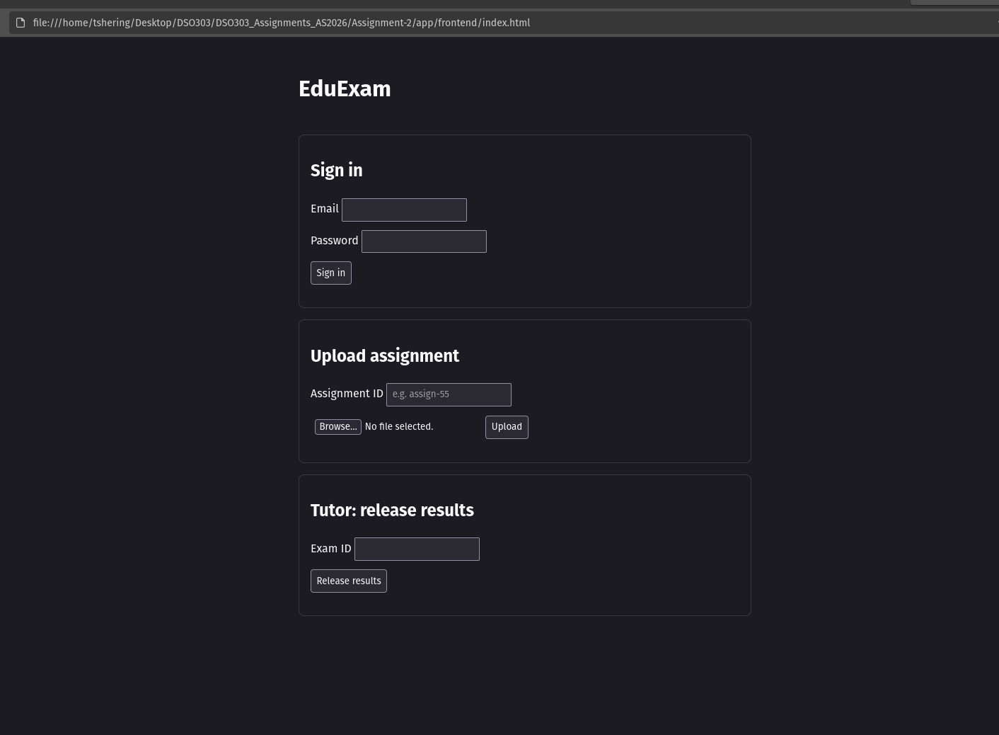
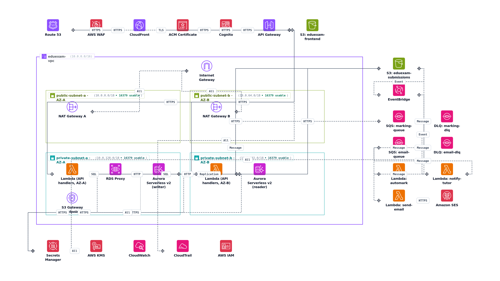
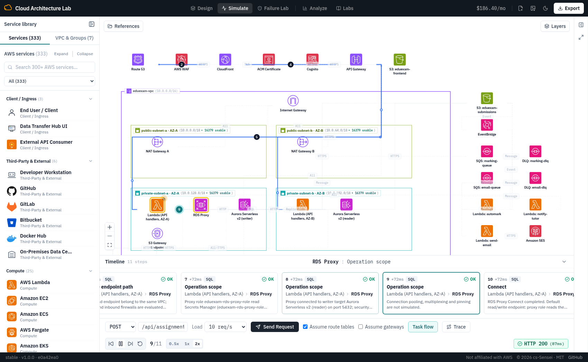
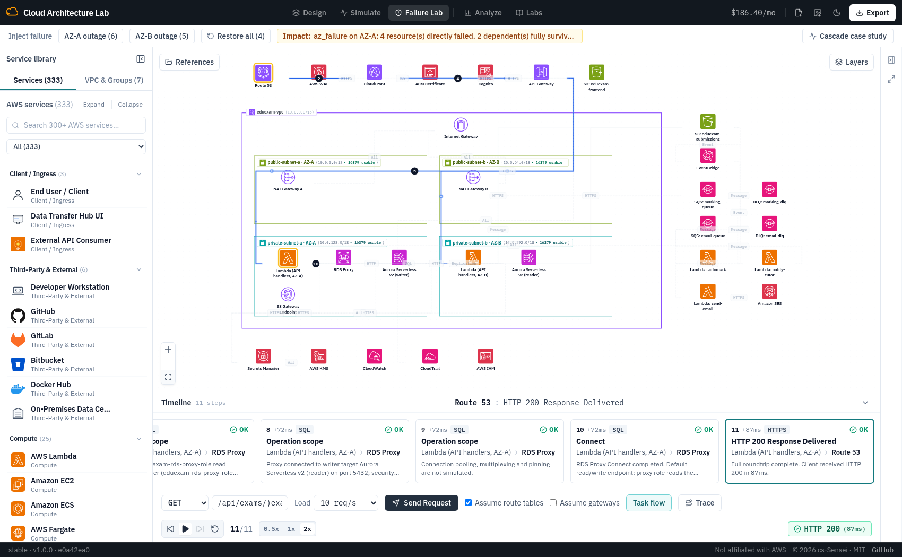
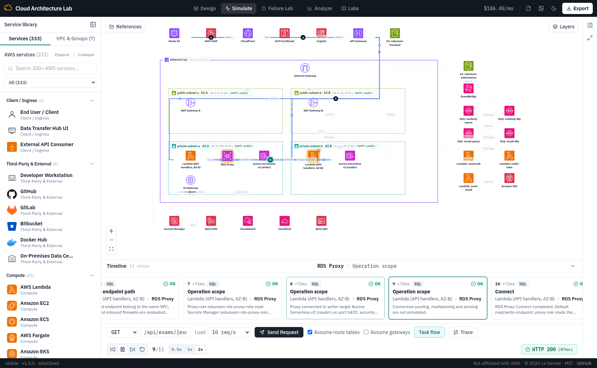
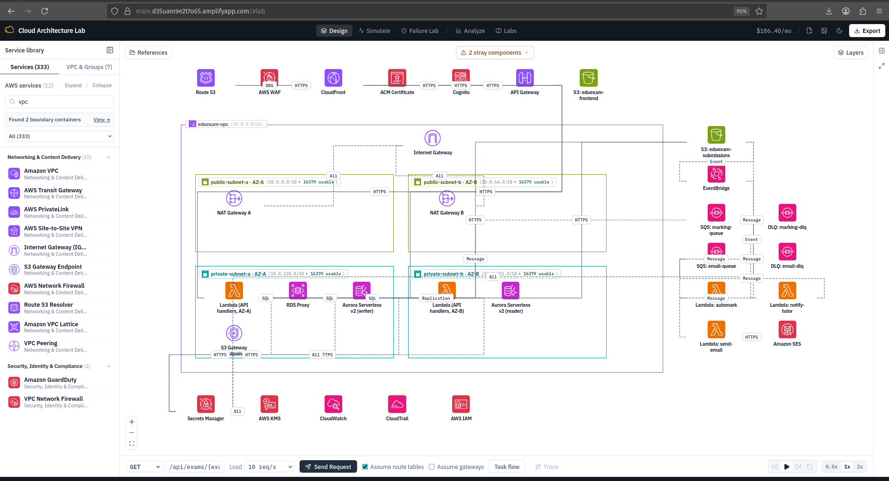
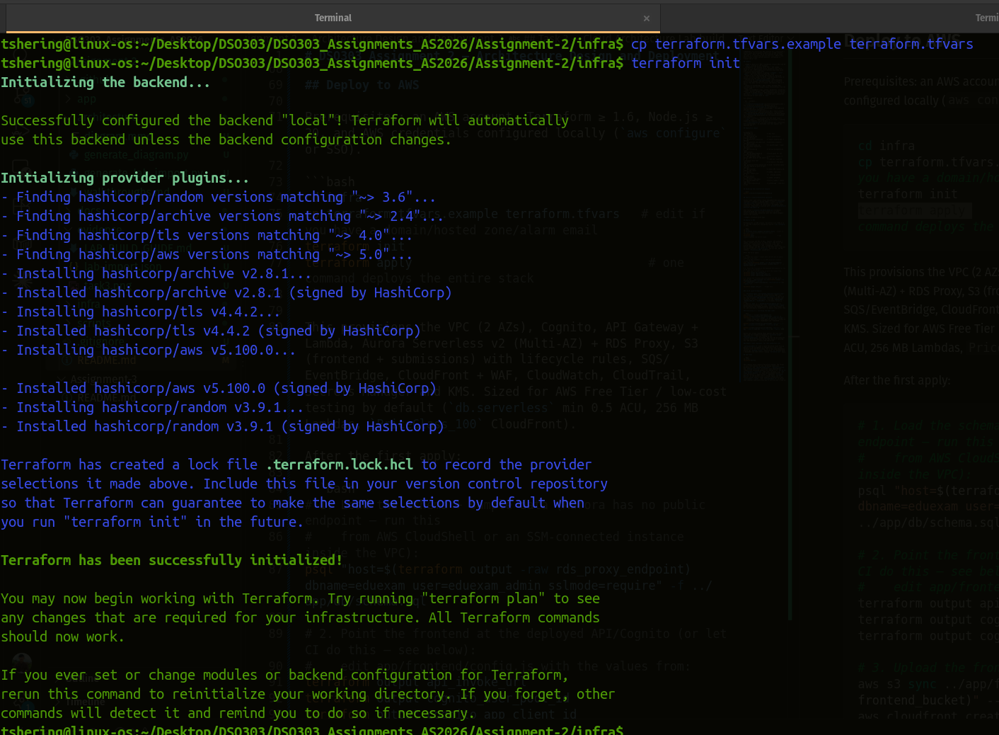

# DSO303 Assignment 2 — Architecture Design and Deployment

**EduExam** — a serverless AWS platform for a university's online exams and assignment submissions (8,000 students, ~400 staff). Built for: 99.9% availability during exams, survival of a single Availability Zone loss, RPO ≤ 5 min, RTO ≤ 1 hour, 5-year record retention, encryption in transit and at rest.



## Summary

- **Edge:** Route 53 → WAF → CloudFront (static SPA from S3 + `/api/*` proxied to API Gateway).
- **Compute:** API Gateway (HTTP API) + AWS Lambda, serverless so the platform scales instantly from ~0 at night to the 3,000-students-in-5-minutes exam-week spike with no pre-provisioned fleet.
- **Auth:** Amazon Cognito, 3 groups (`student`, `tutor`, `admin`), JWT authorizer on every API route.
- **Data:** Aurora PostgreSQL Serverless v2, Multi-AZ (writer in AZ-A, reader in AZ-B), fronted by RDS Proxy for connection pooling under bursty Lambda load.
- **Files:** S3 (`eduexam-submissions`) with presigned direct-to-S3 uploads (PDF/ZIP ≤ 50 MB) and a lifecycle policy that ages records to Glacier and expires them at 5 years.
- **Async:** EventBridge + SQS (+ DLQs) decouple MCQ auto-marking and tutor/student email notifications from the request path.
- **Ops:** CloudWatch (logs, alarms, dashboard), CloudTrail (audit), Secrets Manager + KMS (credentials and encryption).
- **CI/CD:** GitHub Actions, OIDC-authenticated (no stored AWS keys), `terraform apply` + frontend sync + CloudFront invalidation on every push to `main`.

Full details:

| Doc | Contents |
|---|---|
| [`architecture/diagram.mmd`](architecture/diagram.mmd) | Full production architecture (Mermaid source) |
| [`architecture/walkthroughs.md`](architecture/walkthroughs.md) | 2 request walkthroughs + the ≤300-word peak/AZ-resilience explanation |
| [`docs/services.md`](docs/services.md) | Every service: role, configuration, why-over-alternative, connections |
| [`evidence/LAB_BUILD_GUIDE.md`](evidence/LAB_BUILD_GUIDE.md) | Step-by-step build guide for the Cloud Architecture Lab simulator |
| [`infra/`](infra/) | Terraform for the whole stack |
| [`app/`](app/) | Lightweight working prototype (frontend, Lambda API handlers, async workers) |
| [`scripts/simulate.py`](scripts/simulate.py) | Exercises both walkthroughs + an exam-peak load test against the deployed API |

## Repository layout

```
Assignment-2/
├── README.md                    
├── architecture/
│   ├── diagram.mmd              
│   ├── generate_diagram.py     
│   ├── generate_lab_import.py   
│   └── walkthroughs.md          
├── docs/
│   └── services.md              
├── evidence/
│   ├── LAB_BUILD_GUIDE.md       
│   ├── lab-import.json          
│   │                            
├── infra/                       
├── .github/workflows/deploy.yml 
├── app/
│   ├── frontend/               
│   ├── api/                     
│   │                             
│   ├── workers/                 
│   └── db/schema.sql            
└── scripts/simulate.py          
```

## Rendering the architecture diagram

```bash
python3 architecture/generate_diagram.py  
```

## Task 3 — Cloud Architecture Lab build

Fastest path: open <https://main.d35uam9e2t7o65.amplifyapp.com/#lab> → **Export → Upload JSON** → select [`evidence/lab-import.json`](evidence/lab-import.json) → the full architecture (36 nodes, 33 connections, AZ-tagged) loads instantly. Regenerate it anytime with `python3 architecture/generate_lab_import.py`.

Then follow [`evidence/LAB_BUILD_GUIDE.md`](evidence/LAB_BUILD_GUIDE.md) from step 4 onward to run both request-walkthrough simulations plus the **AZ-A outage** Failure Lab scenario.

`evidence/` already contains a full set of screenshots from actually running this build: both walkthroughs return **HTTP 200**, and re-running Walkthrough 1 *during* an injected AZ-A outage still returns **HTTP 200** — routed through the surviving AZ-B Lambda and the Aurora reader. See the "Results" section at the bottom of `LAB_BUILD_GUIDE.md` for the full breakdown (including two real modeling bugs that were found and fixed by actually running the simulator: RDS Proxy must not be tagged to a single AZ, and it needs an explicit `operationLab`/`iamRole` config or the simulator can't resolve the final database hop).

**Full architecture — 36 nodes, 33 connections, zero "stray components" warnings:**



**Walkthrough 1 — student opens an exam, autosave path (`GET /api/exams/{examId}/start` → HTTP 200, 11/11 steps OK):**


**Walkthrough 2 — assignment upload + tutor notification path (`POST /api/assignments/{id}/upload-url` → HTTP 200):**



**AZ-A outage injected in the Failure Lab — dependents fully survive instead of cascading:**



**Resilience check — the same request re-run mid-outage still returns HTTP 200, rerouted through the surviving AZ-B Lambda and the Aurora reader:**





## Deploy to AWS

Prerequisites: an AWS account, Terraform ≥ 1.6, Node.js ≥ 20, and AWS credentials configured locally (`aws configure` or SSO).

```bash
cd infra
cp terraform.tfvars.example terraform.tfvars   
terraform init
terraform apply                                 
```

This provisions the VPC (2 AZs), Cognito, API Gateway + Lambda, Aurora Serverless v2 (Multi-AZ) + RDS Proxy, S3 (frontend + submissions) with lifecycle rules, SQS/EventBridge, CloudFront + WAF, CloudWatch, CloudTrail, Secrets Manager and KMS. Sized for AWS Free Tier / low-cost testing by default (`db.serverless` min 0.5 ACU, 256 MB Lambdas, `PriceClass_100` CloudFront).

After the first apply:

```bash
# 1. Load the schema + sample data (Aurora has no public endpoint 
psql "host=$(terraform output -raw rds_proxy_endpoint) dbname=eduexam user=eduexam_admin sslmode=require" -f ../app/db/schema.sql

# 2. Point the frontend at the deployed API/Cognito (or let CI do this — see below):
#    edit app/frontend/config.js with the values from:
terraform output api_invoke_url
terraform output cognito_user_pool_id
terraform output cognito_app_client_id

# 3. Upload the frontend and invalidate the CDN cache:
aws s3 sync ../app/frontend "s3://$(terraform output -raw frontend_bucket)" --delete
aws cloudfront create-invalidation --distribution-id <id> --paths "/*"

terraform output site_url     # open this
```

### CI/CD (push-to-deploy)

1. `terraform apply -var="github_repo=your-org/your-repo"` once, locally, to create the GitHub Actions OIDC role.
2. `terraform output github_actions_role_arn` → add it as the repo variable `AWS_ROLE_ARN` (Settings → Secrets and variables → Actions → Variables). Also add `DOMAIN_NAME`, `HOSTED_ZONE_ID`, `ALARM_EMAIL` as variables (blank is fine).
3. Push to `main` → [`.github/workflows/deploy.yml`](.github/workflows/deploy.yml) runs `terraform plan`/`apply`, builds/deploys the Lambda packages, syncs the frontend to S3, and invalidates CloudFront — no manual steps after that.

### Exercising it / recording the demo video

```bash
pip install -r scripts/requirements.txt
python3 scripts/simulate.py walkthrough1 --api-url "$(terraform -chdir=infra output -raw api_invoke_url)/api" \
    --exam-id exam-101 --user-pool-id <pool-id> --client-id <client-id> --email you@example.com --password '...'

python3 scripts/simulate.py walkthrough2 --api-url ".../api" --assignment-id assign-55 --file-size-mb 40 ...

python3 scripts/simulate.py az-load-test --api-url ".../api" --exam-id exam-101 --concurrency 100 --requests 3000
```

Record your screen running these against the live stack, then show the CloudWatch dashboard (`terraform output dashboard_url`), the file landing in the `eduexam-submissions` S3 bucket, and (for the AZ scenario) Aurora's Multi-AZ failover in the RDS console — covering the "AWS deployment" rubric item end-to-end.

### Remote state (optional, for real production use)

`infra/providers.tf` uses a local Terraform state file by default so the assignment is reproducible from a clean checkout with zero extra setup. For a real team deployment, switch the `backend "local"` block to an `s3` backend with a DynamoDB lock table before running `terraform init` again.

## Tear-down

```bash
cd infra
terraform destroy
```

This removes every resource Terraform created. Two things it will *not* delete for you, by design (data-loss guardrails): the `eduexam-submissions`, `eduexam-frontend` and `eduexam-cloudtrail` S3 buckets only empty/delete cleanly once versioned objects are removed — run `aws s3 rm s3://<bucket> --recursive` (and clear versions, e.g. `aws s3api delete-objects` for each version/delete-marker, or use the console's "Empty bucket") **before** `terraform destroy` if the buckets aren't already empty; and the Aurora cluster takes a final snapshot automatically when `environment = "prod"` (see `infra/database.tf`) — delete that snapshot separately once you're sure you don't need it.
