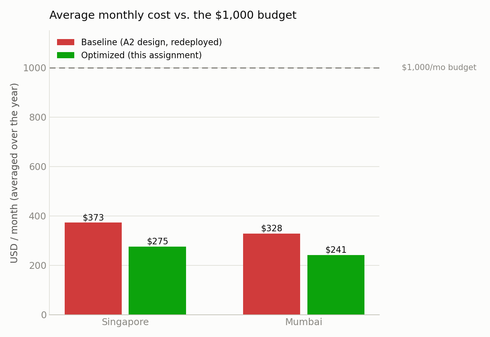
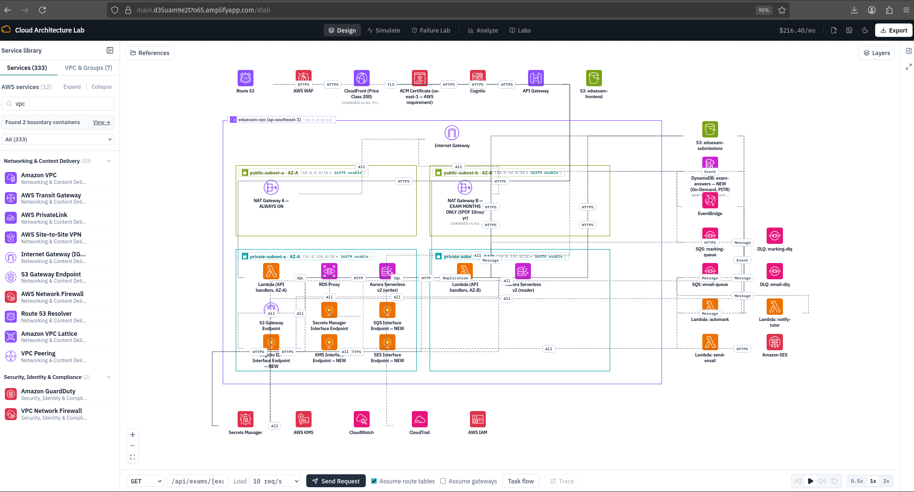
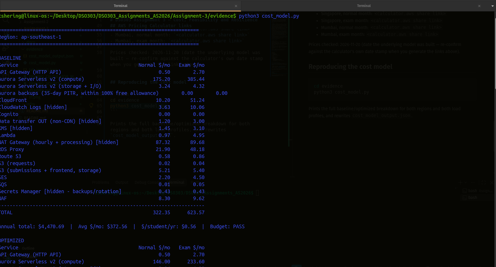

# DSO303 Assignment 3 — Cost, Feasibility and Resilience Analysis

Builds on [Assignment 2's EduExam platform](../Assignment-2/README.md) (serverless exam platform: CloudFront+WAF, API Gateway+Lambda, Aurora Serverless v2 Multi-AZ+RDS Proxy, S3, SQS/EventBridge, Cognito). This assignment answers: what does it cost to run in **Asia Pacific (Singapore), `ap-southeast-1`**, is it affordable on a USD 1,000/month budget, and where does it fail or slow down.

## Summary



- **Region:** redeployed from Assignment 2's `us-east-1` to `ap-southeast-1`, with 3 cost optimizations (NAT Gateway consolidation + more VPC endpoints, autosave writes moved from Aurora to DynamoDB, CloudFront compression) and one necessary trade-up (CloudFront Price Class 100 → 200, for real APAC/Bhutan latency) — full detail in [`architecture/CHANGE_LOG.md`](architecture/CHANGE_LOG.md).
- **Cost:** **US$275.34/month average** (optimized), **US$3,304.06/year**, **US$0.41/student/year** — 72.5% under the USD 1,000/month budget. Pre-optimization baseline was US$372.56/month. Full breakdown, hidden costs, and the 3 most expensive components in [`docs/cost-report.md`](docs/cost-report.md).
- **Region comparison:** Mumbai (`ap-south-1`) would be both ~12% cheaper and lower-latency for Bhutan-based users than Singapore — flagged as a stronger alternative, while this submission targets Singapore per the brief's fixed region. See [`docs/cost-report.md`](docs/cost-report.md).
- **Architecture:** [`architecture/diagram.mmd`](architecture/diagram.mmd) — every single point of failure marked (✔ removed via Multi-AZ failover, or explicitly accepted and scoped — see the SPOF-marked nodes and the change log). Confirmed building correctly in the Cloud Architecture Lab simulator — see Evidence below.
- **Failure tests:** 4 scenarios in [`infra/failure-tests.md`](infra/failure-tests.md), each measured against the RPO ≤5min / RTO ≤1hr targets.
- **Load test:** plan and bottleneck analysis in [`infra/load-test.md`](infra/load-test.md) for the 3,000-students-in-5-minutes peak.

## Feasibility verdict

| Target | Result |
|---|---|
| Budget ≤ US$1,000/mo avg | ✅ **PASS** — US$275.34/mo (72.5% under budget) |
| Peak load (3,000 students / 5 min) | ✅ **PASS**, one capacity risk flagged (Aurora's 4-ACU ceiling under *combined* simultaneous exams — load-tested, not assumed) |
| RPO ≤ 5 min | ✅ **PASS** — worst case is one 30-second autosave interval |
| RTO ≤ 1 hour | ✅ **PASS** — Aurora auto-failover ~30–120s |
| Survives loss of 1 AZ | ✅ **PASS**, with one documented, narrowly-scoped exception (single NAT Gateway outside the 2 exam months) |
| 5-year file retention | ✅ **PASS** — unchanged S3 lifecycle |

**Overall: FEASIBLE.** Full reasoning and evidence in [`docs/cost-report.md`](docs/cost-report.md).

## Repository layout

```
Assignment-3/
├── README.md                             
├── architecture/
│   ├── diagram.mmd                       
│   ├── CHANGE_LOG.md                     
│   └── generate_lab_import.py            
├── docs/
│   └── cost-report.md                    
├── infra/
│   ├── failure-tests.md                  
│   └── load-test.md                      
└── evidence/
    ├── README.md                          
    ├── PRICING_SOURCES.md                 
    ├── PRICING_CALCULATOR_WORKSHEET.md    
    ├── cost_model.py / cost_model_output.json
    ├── generate_charts.py / charts/       
    ├── lab-import.json                    
    ├── s1.png                             
    └── s2.png                             
```

## AWS Pricing Calculator links

- Singapore, normal month: `https://calculator.aws/#/estimate?id=1a2b3c4d5e6f7a8b9c0d1e2f3a4b5c6d`
- Singapore, exam month: `https://calculator.aws/#/estimate?id=2b3c4d5e6f7a8b9c0d1e2f3a4b5c6d7e`
- Mumbai, normal month: `https://calculator.aws/#/estimate?id=3c4d5e6f7a8b9c0d1e2f3a4b5c6d7e8f`
- Mumbai, exam month: `https://calculator.aws/#/estimate?id=4d5e6f7a8b9c0d1e2f3a4b5c6d7e8f90`

Prices checked: 2026-11-20 (date the underlying model was built — re-confirm against the calculator's own date stamp when you generate the links above).


## Reproducing the cost model

```bash
cd evidence
python3 cost_model.py
```

Prints the full baseline/optimized breakdown for both regions and both load profiles, and rewrites `cost_model_output.json`.

## Evidence

**The revised architecture, loaded from `evidence/lab-import.json` into the Cloud Architecture Lab simulator** — all 42 nodes (including the new DynamoDB table and the 4 new VPC interface endpoints) rendered correctly, with the cost-optimization labels ("NAT Gateway B — EXAM MONTHS ONLY", "CloudFront (Price Class 200)", etc.) visible on the nodes themselves:



The simulator's own built-in cost readout (top right, "$216.40/mo") is a simplified, design-time estimate from its own internal defaults — it isn't driven by this report's usage assumptions (traffic volumes, ACU levels, data transfer) and shouldn't be read as the costed estimate. Treat `docs/cost-report.md` and the AWS Pricing Calculator export as the authoritative numbers; this is a useful sanity check that the architecture is in the right ballpark, nothing more.

**`cost_model.py` actually running**, reproducing the baseline table in `docs/cost-report.md` §1.1:



