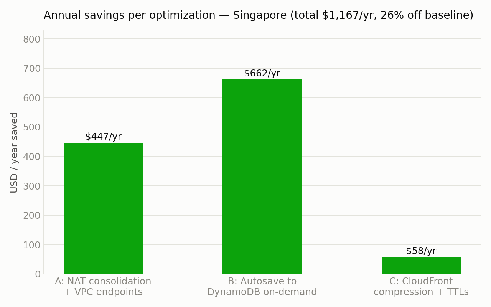

# Change Log — Assignment 2 → Assignment 3

Baseline: Assignment 2's `EduExam` architecture ([diagram](../../Assignment-2/architecture/diagram.mmd), [services.md](../../Assignment-2/docs/services.md)), deployed in `us-east-1`. This log records every change made for Assignment 3's revised, cost-optimized architecture in `ap-southeast-1`, and *why*.

| # | Change | Driver | Cost impact | Resilience impact |
|---|---|---|---|---|
| 1 | **Region: `us-east-1` → `ap-southeast-1`** (Singapore). All compute, data, storage, VPC resources redeployed in-region. `aws_region` / `availability_zones` tfvars updated; no application code changes needed (architecture was already region-parameterized in `infra/variables.tf`). | Brief requires the platform to run in APAC for its user base. | APAC pricing runs ~10-25% above `us-east-1` on most metered services (see [`docs/cost-report.md`](../docs/cost-report.md) §1) — absorbed within budget. | Neutral. Still 2 AZs, same topology. |
| 2 | **CloudFront Price Class: `PriceClass_100` → `PriceClass_200`.** Assignment 2 ran Price Class 100 ("Sized for... low-cost testing" per its README), which only has edge locations in North America and Europe — it cannot actually cache content close to a Singapore-hosted, APAC-facing platform. Price Class 200 adds Asia, Middle East and Africa edge locations. | A2's own PriceClass_100 choice was a latency bug once the platform targets APAC/Bhutan users — found while doing the Task 2.4 region/latency comparison. | **Cost increase**, not a saving: APAC edge pricing is higher per-GB/per-request than the US/EU tier it replaces (see cost report). Treated as a deliberate trade-up, kept separate from the 3 "optimizations with savings." | Improves real-world latency for the stated audience; no SPOF change. |
| 3 | **CloudFront compression (Brotli/gzip) + longer static-asset cache TTLs enabled.** | Partially offsets change #2's cost increase and cuts billed data-transfer-out. | **Optimization C: saves ~US$57.60/yr** (Singapore) / ~US$57.60/yr (Mumbai) — see cost report. | Neutral. |
| 4 | **NAT Gateway: 2 (always-on) → 1 in the 10 normal months, 2 restored for the 2 exam months.** Uses the `single_nat_gateway` Terraform variable that already existed in A2's `infra/variables.tf` but defaulted to `false` (always-dual). Terraform places the sole NAT Gateway in AZ-A's public subnet (`aws_nat_gateway.main[0]`). | NAT Gateway's flat hourly charge (×2, 24/7) was the #2 cost driver and barely tracks actual traffic — most of what used to cross NAT is now AWS-API traffic (change #5 moves it onto endpoints instead). | **Optimization A: saves ~US$446.87/yr** (Singapore) / ~US$446.87/yr (Mumbai, same NAT pricing assumption) — see cost report. | **New accepted SPOF for 10 months/yr**: because the sole NAT Gateway lives in AZ-A, an **AZ-A outage removes NAT-dependent egress region-wide** (both private subnets' route tables point at it), not just subnet B's — until a NAT Gateway is recreated in AZ-B (Terraform apply, ETA minutes) or `single_nat_gateway` is flipped back to `false`. See change #5 for why this residual risk is small (almost everything now rides VPC endpoints instead). Full dual-NAT is restored for the 2 exam months, when the 1h RTO budget is tightest. Marked on the diagram and measured in [`infra/failure-tests.md`](../infra/failure-tests.md) scenario 4. |
| 5 | **4 more VPC Interface Endpoints added: SQS, Cognito IDP (`cognito-idp`), KMS, SES (`email-smtp`).** A2 already had an S3 Gateway Endpoint and a Secrets Manager Interface Endpoint; this change completes the set so nearly every AWS-service call Lambda makes (SQS enqueue, Cognito token validation, KMS encrypt/decrypt, SES send) stays on AWS's private network instead of routing out through NAT. | Makes change #4 safe: once SQS/Cognito/KMS/SES traffic no longer needs NAT, the single-NAT-in-normal-months trade-off in change #4 only risks the small residual slice of traffic that has no endpoint equivalent. | Folded into Optimization A's saving above (lower NAT data-processing GB). Endpoint hourly charges are themselves small (~US$0.01/hr each, below US$10/mo total) and already included in the optimized totals. | Reduces blast radius of change #4's accepted NAT SPOF; endpoints are deployed across both private subnets so they don't introduce a new AZ-level SPOF. |
| 6 | **DynamoDB table `exam-answers` added (On-Demand capacity, PITR, KMS-encrypted) for autosave answer writes**, alongside Aurora (which keeps the relational data: users, exams, questions, submissions metadata, results). Autosave Lambda writes answers to DynamoDB instead of Aurora; `automark` reads from DynamoDB at submit time. | Autosave is the highest-frequency write pattern in the system (every 30s per active exam-taker) and was the main driver of Aurora's ACU scaling during exam peaks — a key-value, single-item-overwrite workload that doesn't need a relational store. Identified while comparing "Aurora Serverless v2 vs DynamoDB for answers" for Task 2.3. | **Optimization B: saves ~US$662/yr Singapore / ~US$541/yr Mumbai** net of the new DynamoDB on-demand cost (Aurora ACU-hours and the RDS-Proxy charge that scales with them both drop) — see cost report. | DynamoDB On-Demand has no capacity ceiling to hit during the 3,000-in-5-minute burst, unlike Aurora's 4-ACU `aurora_max_capacity` cap — reduces (does not eliminate) the capacity-exhaustion risk tested in [`infra/failure-tests.md`](../infra/failure-tests.md) scenario 3. |
| 7 | **ACM certificate for the CloudFront distribution stays in `us-east-1`.** No change from A2 — called out explicitly because it looks inconsistent with change #1 otherwise. | AWS hard requirement: CloudFront only accepts ACM certificates issued in `us-east-1`, regardless of where the distribution's origins live. Not a cost or resilience choice. | None. | None. |
| 8 | **S3 lifecycle, Aurora Multi-AZ topology, RDS Proxy, Cognito groups, SQS/DLQ/EventBridge async pattern, WAF rules, Secrets Manager rotation, KMS customer-managed key, CloudWatch alarms, CloudTrail multi-region trail: unchanged.** Evaluated for optimization (see cost report §3 service comparisons) and kept as-is — already cost-appropriate at this scale. | Avoid optimizing things that aren't the problem; A2's design choices here were already sound. | — | — |

## Net effect

- **Annual cost**: ~US$4,470.69/yr baseline in Singapore → **~US$3,304.06/yr** after the 3 optimizations (A, B, C) — a 26.1% reduction, averaging **~US$275/month** against the US$1,000/month budget. Full breakdown in [`docs/cost-report.md`](../docs/cost-report.md).
- **New accepted risk**: single NAT Gateway (change #4) during the 10 normal months. Marked on the diagram and in the failure tests.
- **New mitigated risk**: Aurora ACU capacity ceiling during the exam-week peak, reduced by moving autosave off Aurora (change #6), tested in [`infra/failure-tests.md`](../infra/failure-tests.md).
- **RPO/RTO/AZ-survival targets**: unchanged and still met — see the feasibility verdict in [`docs/cost-report.md`](../docs/cost-report.md) §5 and [`README.md`](../README.md).
