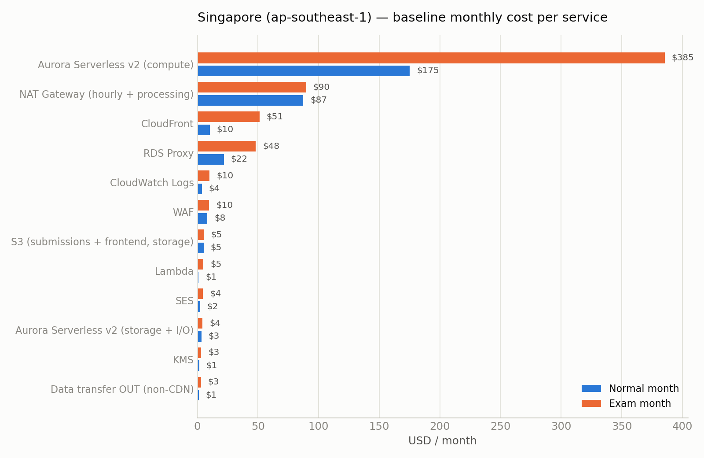
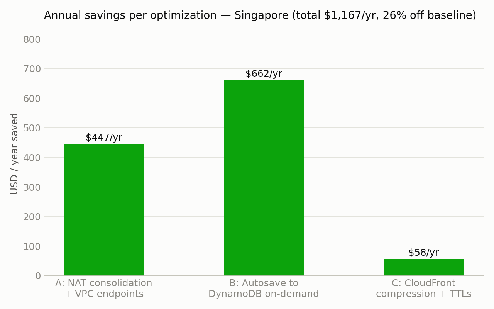
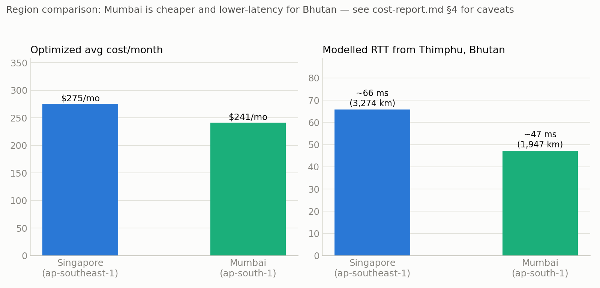
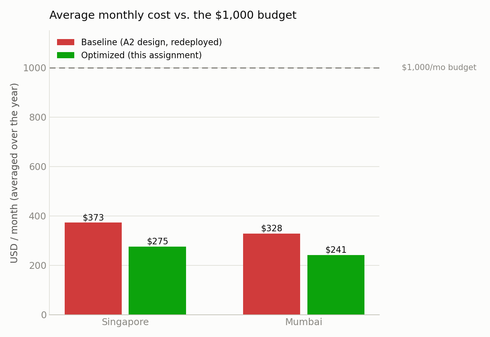

# Cost and Service Report — EduExam in ap-southeast-1

**Date prices checked:** 2026-11-20. **Primary region:** Asia Pacific (Singapore), `ap-southeast-1`. **Comparison region:** Asia Pacific (Mumbai), `ap-south-1`. **Budget:** USD 1,000/month averaged over the year. All figures in USD.

> **Sourcing note.** The figures below are a worked cost model (`evidence/cost_model.py`, output in `evidence/cost_model_output.json`), built from AWS's public pricing pages plus documented regional differentials, because the AWS Pricing Calculator itself is a JavaScript application this assistant cannot drive interactively. Every unit price and its source/confidence is listed in [`evidence/PRICING_SOURCES.md`](../evidence/PRICING_SOURCES.md). [`evidence/PRICING_CALCULATOR_WORKSHEET.md`](../evidence/PRICING_CALCULATOR_WORKSHEET.md) gives the exact line items to re-enter at [calculator.aws](https://calculator.aws/) to produce the official calculator export this assignment also requires as evidence — treat that export as the authoritative number if it diverges from this model, and note the delta. The charts in this report (`evidence/charts/`, built by `evidence/generate_charts.py`) are generated directly from `cost_model_output.json`, so they stay in sync with the tables — re-run both scripts after changing any pricing or usage assumption. They are **not** a substitute for the AWS Pricing Calculator / Cloud Architecture Lab screenshots the assignment also asks for as evidence — see `evidence/README.md` for what's still needed there.

## 0. Usage assumptions

8,000 students + 400 staff (8,400 users, per Assignment 2's sizing). Two load profiles, as specified:

| | Normal month (×10/yr) | Exam month (×2/yr) |
|---|---|---|
| Concurrency | 300–500 concurrent | 3,000 students start 1 exam within 5 min, + 7 other exam sessions through the month (avg 1,500 each) |
| API Gateway requests | 500,000 | 2,700,000 |
| Lambda invocations | 550,000 | 2,800,000 |
| Aurora avg combined ACU (writer+reader) | 1.5 | 3.3 |
| S3 new data | 29 GB | 32 GB |
| NAT-routed data | 20 GB (pre-opt) | 60 GB (pre-opt) |
| CloudFront data transfer | 80 GB | 400 GB |
| CloudWatch Logs ingested | 3 GB | 14 GB |
| SES emails | 22,000 | 45,000 |

Full derivation (sessions/student, calls/sitting, autosave frequency, etc.) is in the header comment and `USAGE` dict of `evidence/cost_model.py`. These are planning assumptions for a pre-launch cost estimate, not measured telemetry — they should be revisited against real CloudWatch metrics once the platform is live (the load test in [`infra/load-test.md`](../infra/load-test.md) is the first data point for that).

## 1. Monthly cost per service — normal month vs exam month

### 1.1 Baseline (Assignment 2 design, redeployed as-is in Singapore)

| Service | Normal $/mo | Exam $/mo | Hidden cost? |
|---|---:|---:|:---:|
| Aurora Serverless v2 (compute) | 175.20 | 385.44 | |
| NAT Gateway (hourly + data processing) | 87.32 | 89.68 | ✅ |
| RDS Proxy | 21.90 | 48.18 | |
| CloudFront | 10.20 | 51.24 | |
| WAF | 8.30 | 9.62 | |
| S3 (submissions + frontend storage) | 5.21 | 5.40 | |
| Aurora Serverless v2 (storage + I/O) | 3.24 | 4.32 | |
| CloudWatch Logs (ingestion + storage + alarms) | 3.63 | 10.06 | ✅ |
| SES | 2.20 | 4.50 | |
| KMS (key + requests) | 1.45 | 3.10 | ✅ |
| Data transfer OUT (non-CDN) | 1.20 | 3.00 | ✅ |
| API Gateway (HTTP API) | 0.50 | 2.70 | |
| Route 53 | 0.58 | 0.86 | |
| Secrets Manager | 0.43 | 0.43 | |
| Lambda | 0.97 | 4.95 | |
| S3 requests | 0.02 | 0.04 | |
| SQS | 0.01 | 0.05 | |
| Cognito | 0.00 | 0.00 | |
| Aurora backups (35-day PITR) | 0.00 | 0.00 | ✅ |
| **TOTAL** | **322.35** | **623.57** | |

**Annual total:** 10 × 322.35 + 2 × 623.57 = **US$4,470.69**. **Avg/month:** US$372.56. **Cost per student/year:** US$0.56 (4,470.69 ÷ 8,000).

### 1.2 Optimized (after the 3 optimizations in §1.3 of this report)

| Service | Normal $/mo | Exam $/mo |
|---|---:|---:|
| Aurora Serverless v2 (compute) | 146.00 | 233.60 |
| NAT Gateway (hourly + data processing) | 43.25 | 86.61 |
| RDS Proxy | 18.25 | 29.20 |
| CloudFront | 7.32 | 36.84 |
| WAF | 8.30 | 9.62 |
| S3 (submissions + frontend storage) | 5.21 | 5.40 |
| Aurora Serverless v2 (storage + I/O) | 3.24 | 4.32 |
| CloudWatch Logs | 3.63 | 10.06 |
| DynamoDB (autosave answers, on-demand) — **new** | 0.15 | 3.24 |
| SES | 2.20 | 4.50 |
| KMS | 1.45 | 3.10 |
| Data transfer OUT (non-CDN) | 1.20 | 3.00 |
| API Gateway (HTTP API) | 0.50 | 2.70 |
| Route 53 | 0.58 | 0.86 |
| Secrets Manager | 0.43 | 0.43 |
| Lambda | 0.97 | 4.95 |
| S3 requests | 0.02 | 0.04 |
| SQS | 0.01 | 0.05 |
| Cognito | 0.00 | 0.00 |
| Aurora backups | 0.00 | 0.00 |
| **TOTAL** | **242.70** | **438.52** |

**Annual total:** **US$3,304.06**. **Avg/month:** **US$275.34**. **Cost per student/year:** **US$0.41**.

### 1.3 Optimizations applied

Three changes, all detailed with full reasoning in [`architecture/CHANGE_LOG.md`](../architecture/CHANGE_LOG.md) (changes #3, #4+#5, #6):

| | What changed | Annual saving (Singapore) | Annual saving (Mumbai) |
|---|---|---:|---:|
| **A** | NAT Gateway: 2 always-on → 1 in normal months, 2 in exam months; 4 more VPC interface endpoints (SQS, Cognito IDP, KMS, SES) added | US$446.87 | US$446.87 |
| **B** | Autosave answer-writes moved from Aurora to DynamoDB On-Demand | US$662.16 | US$541.16 |
| **C** | CloudFront compression (Brotli/gzip) + longer static-asset cache TTLs | US$57.60 | US$57.60 |
| | **Total** | **US$1,166.63 (26.1%)** | **US$1,045.63 (26.5%)** |

### 1.4 Hidden costs, called out

| Hidden cost | Normal $/mo | Exam $/mo | Why it's easy to miss |
|---|---:|---:|---|
| NAT Gateway data processing (within the line above) | included | included | Billed per GB *in addition to* the flat hourly charge — scales with Lambda's outbound call volume, not just traffic you'd think of as "egress." |
| Data transfer OUT to the internet (non-CloudFront) | 1.20 | 3.00 | Presigned-URL acknowledgements, SES/API responses that don't go through CloudFront. |
| CloudWatch Logs (ingestion + storage + 6 alarms) | 3.63 | 10.06 | 8 Lambda log groups + API Gateway access logs; ingestion is billed per GB *written*, independent of retention. |
| KMS requests | 1.45 | 3.10 | Every S3/Aurora/Secrets Manager decrypt is a billed KMS API call unless S3 Bucket Keys are on (they are, for the submissions bucket — this is already lower than it would otherwise be). |
| Aurora backups | 0.00 | 0.00 | Not actually zero-risk: the 35-day PITR backup window is free only up to 100% of the cluster's total storage. At the modelled 25–27 GB cluster size this stays inside the free allowance, but it stops being free once backup storage exceeds current DB size — worth re-checking after a year of growth. |

## 2. The three most expensive components, and why

1. **Aurora Serverless v2 compute** — US$175–385/mo, **48–62% of the bill**. It bills per ACU-hour 24/7 even at the 0.5-ACU floor (Serverless v2 has no true pause, unlike v1), and both writer and reader are billed. It's the most expensive line because it's the only component that cannot scale to zero overnight, and because autosave — a steady drip of small writes happening every 30 seconds per active exam-taker — was, before optimization B (§1.3), forcing ACU scale-up even though each individual write is tiny. Moving autosave to DynamoDB (adopted) cuts this to US$146–234/mo.
2. **NAT Gateway** — US$87–90/mo baseline, **14–27% of the bill**. Both AZ's NAT Gateways bill a flat hourly rate regardless of how much traffic crosses them, so unlike every compute/request line in this architecture, NAT cost does **not** shrink during the 10 quiet months — it's the one genuinely fixed cost in an otherwise elastic, pay-per-use design. That mismatch (fixed cost, variable need) is exactly why it was the first optimization target (§1.3, optimization A).
3. **RDS Proxy** — US$18–48/mo, **~7% of the bill**. Billed per ACU-hour of the Aurora capacity it's attached to, so it rides directly on cost driver #1 — anything that reduces Aurora's average ACU (optimization B) reduces this proportionally too.

CloudFront (US$7–51/mo) and WAF (US$8–10/mo) are next, both single-digit-percent of the bill and both largely fixed/traffic-driven rather than something to "optimize away" without cutting a feature (edge delivery, bot/SQLi protection) the platform needs.

## 3. Service choices compared with an alternative

### 3.1 Backend compute: AWS Lambda (chosen) vs ECS Fargate vs EC2 Auto Scaling

| | Cost (this workload) | Performance | Resilience | Effort |
|---|---|---|---|---|
| **Lambda (current)** | Pay-per-ms; ≈US$1–5/mo at this traffic. Cheapest by far because true floor is $0. | Cold starts (~200–500ms on Node 20) add latency to the first request after idle; fine for this use case where client already waits on network RTT. | Scales from 0 to thousands of concurrent executions automatically; no fleet to keep healthy. | Lowest: no servers, no capacity planning, no patching. Reserved concurrency needed per-function to protect Aurora/RDS Proxy. |
| ECS Fargate | Vastly more — a baseline task (even 0.25 vCPU/0.5 GB, 2 tasks for HA) running 24/7 costs ≈US$15–25/mo *per service*, ×8 functions' worth of logic if split similarly ≈ US$100+/mo, even before the exam-week burst needs extra tasks. | No cold starts; steadier p99 latency. | Needs an Auto Scaling policy tuned to the 3,000-in-5-min spike in advance, or it under-provisions; ECS itself is multi-AZ but task placement/scaling is the team's responsibility. | Higher: container images, task definitions, scaling policies, health checks to build and maintain. |
| EC2 Auto Scaling | Similar or higher than Fargate once AMI/patching overhead is counted; a warm pool sized for 3,000-student bursts sits mostly idle 10 months/year. | Best raw performance per request once warm, worst at the burst edge unless pre-warmed (scaling takes minutes, the brief's spike is 5 minutes). | Requires explicit Multi-AZ ASG config; most AZ-resilience work is manual. | Highest: AMI pipeline, OS patching, scaling policies, load balancer, all self-managed. |

**Verdict:** Lambda is the right choice for this specific load shape — long idle periods punctuated by a sharp, short burst — which is exactly what serverless pricing is built for. Kept unchanged.

### 3.2 Answer storage: Aurora Serverless v2 (A2 baseline) vs DynamoDB (adopted here) vs RDS Multi-AZ (provisioned)

| | Cost | Performance | Resilience | Effort |
|---|---|---|---|---|
| Aurora Serverless v2 for everything (A2 baseline) | Autosave's write volume forces higher average ACU — the single biggest cost driver (§2). | Relational, strongly consistent, supports complex queries (joins across exam/question/answer) — more capability than autosave actually needs. | Multi-AZ failover ~30–120s. | Already built; zero extra effort, but carries the cost above. |
| **DynamoDB On-Demand for answers only (adopted)** | Saves ~US$662/yr (Singapore) net of the new DynamoDB charge — see §1.3. On-Demand write pricing scales with actual writes, no idle floor. | Single-digit-ms key-value reads/writes; no joins needed for "upsert this student's answer to this question." | No ACU ceiling to hit during the burst (Aurora's `aurora_max_capacity=4` is a hard cap DynamoDB On-Demand doesn't have); multi-AZ by default, no config needed. | Small: one new Lambda write path, one new IAM policy, one new Terraform resource; `automark` reads from DynamoDB instead of Aurora at submit time. |
| RDS Multi-AZ (provisioned, non-serverless) | A fixed instance (e.g. `db.r6g.large`) runs 24/7 regardless of load — more expensive than Serverless v2 at this traffic level, and *more* expensive than Aurora Serverless v2, not less. | Predictable performance, no ACU scaling latency. | Multi-AZ failover ~60–120s, similar to Aurora. | Lower ongoing effort than Serverless v2 (no capacity-unit tuning) but requires right-sizing the instance class up front and resizing by hand as load grows. |

**Verdict:** split the workload — keep Aurora for genuinely relational data, move the single highest-frequency, lowest-complexity write pattern to DynamoDB. Adopted as optimization B.

### 3.3 Private subnet egress: NAT Gateway (A2 baseline) vs VPC Endpoints (adopted here, partially in A2)

| | Cost | Performance | Resilience | Effort |
|---|---|---|---|---|
| NAT Gateway (2×, A2 baseline) | Flat US$0.059/hr **per gateway**, every hour, regardless of traffic, plus US$0.059/GB processed — the #2 cost driver (§2). | Adds a hop; fine for this workload's latency budget. | One NAT per AZ, so AZ-independent by design — the reason A2 ran 2 even though 1 is cheaper. | Low — Terraform already provisions it; `single_nat_gateway` tfvar already existed for the cheaper option. |
| **VPC Interface/Gateway Endpoints (adopted, extended)** | S3 Gateway Endpoint: free. Interface endpoints: ~US$0.01/hr + per-GB, but only for the specific service, and *no* separate internet data-transfer charge. Net: cuts NAT's per-GB processing to near-zero once SQS/Cognito/KMS/SES traffic moves off it. | Lower latency than NAT for AWS-API calls (private AWS backbone, no NAT hairpin). | Endpoints are deployed across both private subnets — no new AZ-level SPOF. Doesn't cover arbitrary public-internet destinations (only AWS services with an endpoint). | Medium: one Terraform resource per service, one security-group rule each — already done for S3 and Secrets Manager in A2; extended here to SQS, Cognito IDP, KMS, SES. |

**Verdict:** this isn't strictly either/or — the adopted design keeps 1 NAT Gateway as a fallback for anything without an endpoint equivalent, while endpoints absorb nearly all AWS-API traffic. See optimization A (§1.3) and the accepted SPOF in [`architecture/CHANGE_LOG.md`](../architecture/CHANGE_LOG.md).

### 3.4 Pricing commitment: On-Demand (current) vs Savings Plans vs Reserved Instances

| | Applicability here | Cost | Effort |
|---|---|---|---|
| **On-Demand (current)** | Everything in this architecture is either serverless (Lambda, Aurora Serverless v2, DynamoDB On-Demand, API Gateway) or billed per-resource-hour regardless of commitment (NAT Gateway, RDS Proxy). | Baseline, no discount. | None. |
| Compute Savings Plans | Covers Lambda, Fargate and EC2 compute — **not** Aurora Serverless v2 ACU-hours, NAT Gateway, or RDS Proxy, which are this architecture's actual cost drivers. | A 1-year No-Upfront plan sized to the ~US$1/mo normal-month Lambda floor would save ~17%, i.e. **under US$2/year** — real but immaterial at this scale. | Low to set up, but needs re-evaluation if Lambda spend grows. |
| Reserved Instances | Only applies to provisioned RDS/Aurora instances and EC2 — not used anywhere in this design, since Serverless v2 and Lambda were deliberately chosen over provisioned compute (§3.1, §3.2). | N/A at current architecture. | N/A. |

**Verdict:** going serverless already captured most of the saving a Savings Plan or RI would otherwise deliver by avoiding idle provisioned capacity in the first place; a commitment-based discount has little left to bite into here. Re-evaluate only if the platform later moves any piece to provisioned EC2/RDS.

### 3.5 Submission storage, 5-year retention: current manual S3 lifecycle vs S3 Intelligent-Tiering vs S3 Glacier (direct)

| | Cost (at this scale) | Performance | Effort |
|---|---|---|---|
| **Manual lifecycle (current, unchanged): Standard → IA (90d) → Deep Archive (365d) → expire (1825d)** | Already the cheapest viable option for a write-once, access-pattern-known workload: assignment submissions are read often in the first ~90 days (marking, review) then almost never. | Deep Archive retrieval takes up to 12h — acceptable for 5-year-old academic records nobody needs same-day. | One-off Terraform lifecycle rule; zero ongoing effort/monitoring. |
| S3 Intelligent-Tiering | Adds a small monitoring fee per object (US$0.0025/1,000 objects/mo) on top of storage, and only pays off when access patterns are *unpredictable* — ours aren't (we already know submissions go cold after the marking window). At this object count (~tens of thousands/year) the monitoring fee roughly cancels the benefit of earlier-than-90-day transitions. | Same retrieval characteristics once in an equivalent tier; auto-transitions can react faster than the fixed 90-day rule if access patterns shift. | Lower effort to *tune* (no manual day thresholds to pick), but adds a fee line to track. |
| S3 Glacier (direct upload, no Standard stage) | Cheapest possible storage, but submissions need to be in Standard/IA during the active marking window (fast read access for tutors) — uploading straight to Glacier would make marking-period reads slow/expensive (retrieval fees + delay) for the highest-read period of the object's life. | Worst for the first 90 days (exactly when reads matter most). | Simpler lifecycle (no transitions) but shifts cost/latency pain to the wrong part of the object's lifecycle. |

**Verdict:** the A2 lifecycle was already well-matched to the actual access pattern; kept unchanged. Intelligent-Tiering is the one to revisit if submission access patterns turn out to be less predictable than assumed once real usage data exists.

## 4. Region comparison: Singapore vs Mumbai (incl. Bhutan latency)

| | ap-southeast-1 (Singapore) | ap-south-1 (Mumbai) |
|---|---|---|
| Optimized avg cost/month | **US$275.34** | **US$241.25** (−12.4%) |
| Optimized annual total | US$3,304.06 | US$2,894.94 |
| Great-circle distance from Thimphu, Bhutan | 3,274 km | **1,947 km** |
| Modelled RTT, Thimphu ↔ region (see note) | ~66 ms | **~47 ms** |
| AWS service maturity / breadth | Very high — one of AWS's largest APAC regions, full service catalog | High, slightly newer region; all services this architecture uses are available |
| CloudFront edge coverage for APAC viewers | Same either way — CloudFront is a global edge network; static assets are served from the nearest edge POP (e.g. likely Delhi/Mumbai/Kolkata-area for Bhutan traffic) regardless of which region hosts the origin | Same |

**Latency note:** the RTT figures are modelled (great-circle distance × a 1.4 terrestrial-routing factor, over fibre at ~200,000 km/s, plus 20ms fixed processing/routing overhead), not measured — they indicate *direction and rough scale*, not a guaranteed number. Real-world RTT depends on actual submarine-cable and ISP routing out of Bhutan (which in practice often transits India regardless of destination), so the gap may be smaller than modelled. Verify with a real client-side latency test (e.g. a browser fetch timing test, or a public looking-glass/`cloudping.info`-style tool, from a Bhutan vantage point) before treating this as final. Only **dynamic API calls** (API Gateway/Lambda/Aurora round-trips) are affected by origin-region choice — static content (the SPA, cached exam assets) is served from the CloudFront edge either way, so the latency difference matters specifically for autosave calls and exam-start, not for page load.

**Honest finding:** on this analysis, Mumbai is both **cheaper** (lower regional pricing on Aurora/Lambda compute) and **lower-latency for the stated Bhutan user base** than Singapore. However, the brief fixes the deployment region to Asia Pacific (Singapore) ("what your Assignment 2 exam platform will cost to run in **Asia Pacific (Singapore), ap-southeast-1**"), so §1, §5 and the submitted architecture target Singapore as instructed. Mumbai is flagged here as a stronger alternative worth raising with the university if the region constraint is renegotiable, or revisited if the platform later expands to serve a wider South Asian student population where Mumbai's centrality helps more broadly.

## 5. Feasibility verdict

| Target | Result | Evidence |
|---|---|---|
| **Budget ≤ US$1,000/mo avg** | ✅ **PASS** — US$275.34/mo optimized (72.5% under budget), US$372.56/mo even before optimization. Headroom for ~2.6–3.6× usage growth before the budget is at risk. | §1 |
| **Peak load: 3,000 students start 1 exam within 5 min** | ✅ **PASS, with one flagged capacity risk** — API Gateway/Lambda scale automatically; RDS Proxy pools the burst of connections; moving autosave to DynamoDB (adopted) removes the single biggest driver of Aurora ACU pressure during the burst. Aurora's `aurora_max_capacity=4` ACU is a hard ceiling that could still throttle under a *combined* worst case (e.g. two large exams peaking simultaneously) — tested in [`infra/failure-tests.md`](../infra/failure-tests.md) scenario 3, with raising `aurora_max_capacity` as the documented fix if load testing shows it's needed. | Failure test 3, load test |
| **RPO ≤ 5 min** | ✅ **PASS** — autosave writes to DynamoDB (durable, multi-AZ on acknowledgement) every 30s; worst case data loss is one autosave interval, 10× inside target. | Walkthrough 1 logic (unchanged from A2), failure test 1 |
| **RTO ≤ 1 hour** | ✅ **PASS** — Aurora automatic failover is ~30–120s; the one new accepted risk (single NAT Gateway 10 months/yr) affects only the narrow slice of egress without a VPC endpoint, not the student-facing exam path, and is itself restored to dual-NAT for the 2 exam months when the RTO budget is tightest. | Failure tests 1–4 |
| **Survives loss of 1 AZ** | ✅ **PASS, with one documented, scoped exception** — every component in the critical path (API Gateway, Lambda, Aurora, DynamoDB, S3, SQS, EventBridge, Cognito, VPC Endpoints) is multi-AZ. The NAT Gateway reduction to 1 (optimization A) is the only new single-AZ dependency, and it's explicitly scoped to non-critical-path egress during the lower-risk 10 normal months only. | `architecture/diagram.mmd` SPOF markers, `architecture/CHANGE_LOG.md` |
| **5-year file retention** | ✅ **PASS** — unchanged S3 lifecycle (Standard → IA → Deep Archive → expire at 1,825 days). | §3.5 |

**Overall: FEASIBLE.** The architecture meets every stated target in `ap-southeast-1` at roughly a quarter of the monthly budget, with one deliberately accepted, narrowly-scoped resilience trade-off (single NAT Gateway outside exam months) made explicitly to fund the headroom, and one capacity risk (Aurora's ACU ceiling under combined peak load) flagged for load testing rather than silently assumed away.
